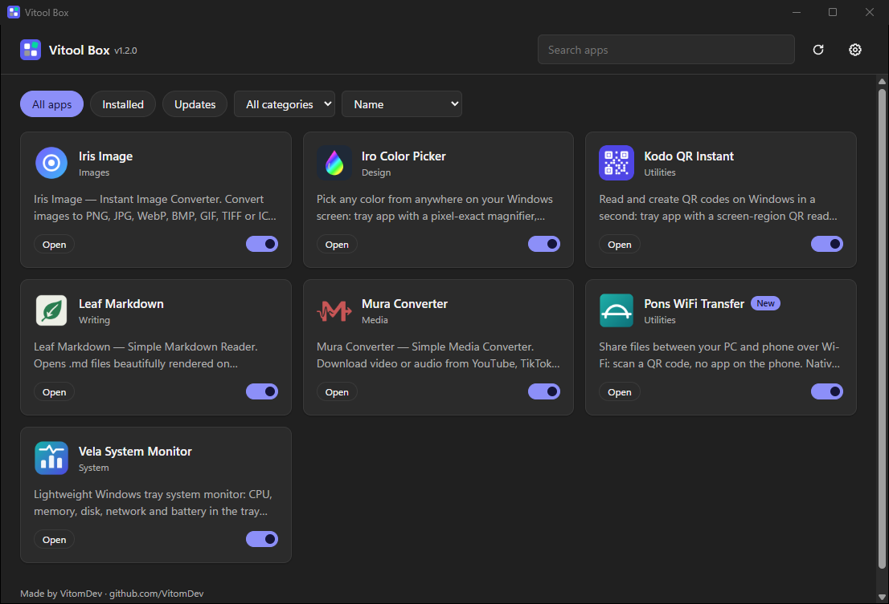

<p align="center"></p>

# 🧰 Vitool Box
[](https://opensource.org/licenses/MIT)

All VitomDev mini apps in one place. 📦  
Browse the apps, read what each one does, and turn on the ones you want: Vitool Box downloads and installs them for you. Turn one off and it's uninstalled. New apps show up on their own.

<p align="center"></p>

---

## 🚀 Features

- 🗂️ **App catalog**: every Vitool Box app with its icon, description, screenshots and release notes
- 🔘 **Turn apps on and off**: on downloads and installs the app, off uninstalls it. No setup wizards
- ☑️ **Install several at once**: pick them and they install one after another
- ⬆️ **Updates**: update with one click right from the app list, or all at once
- 🔔 **Update notifications**: starts with Windows, waits in the notification area and lets you know when there are updates
- 🗃️ **Group your apps' icons** (optional, off by default): one Vitool Box icon next to the clock instead of one per app; click an app to use it, right-click for its menu
- 🕰️ **Version history**: read the notes of every release and go back to an older version if a new one gives you trouble
- 🔄 **Updates itself**: Vitool Box downloads its new version and restarts into it
- 🤖 **Optional auto-update**: install your apps' updates every time you open Vitool Box
- 💾 **Settings backup**: save the settings of your apps to a file and restore them later or on another PC
- ✨ **New apps appear automatically**, without updating Vitool Box, with a *New* badge
- 🔍 **Search**, filter by *Installed*, *Updates* or category, and sort by name, newest or recently updated
- ▶️ **Open** installed apps straight from their card, open their folder or repair them
- 🧹 **Closes open apps** before updating them and starts them again afterwards
- ⏸️ **Cancel** a download and **retry** when something fails
- 🌍 **10 languages**: English, Español, Português (Brasil), Français, Deutsch, Italiano, Polski, 日本語, 한국어 and 简体中文
- 🛡️ **Safe downloads**: only official VitomDev releases, each checked against its SHA-256 checksum before it runs
- 👀 Notices apps you installed or removed by other means (Settings → Apps)
- 🌙 Clean Windows 11 look that follows your light or dark theme
- 🪶 Small: no .NET or Visual C++ runtime needed

---

## 📦 Install

Download `VitoolBoxSetup.exe` from [Releases](https://github.com/VitomDev/Vitool-Box/releases/latest) and run it.

- Per-user install, no admin rights needed
- Needs the Microsoft Edge WebView2 Runtime, which comes with Windows 11 and up-to-date Windows 10

Uninstalling Vitool Box (Settings → Apps) keeps the apps you installed with it.

---

## 🖱️ Usage

| Action | How |
| --- | --- |
| Install an app | Turn on its switch, or open it and click **Install** |
| Uninstall an app | Turn off its switch, or open it and click **Uninstall** |
| Update an app | Click **Update to x.y.z** on its card or its page |
| Install several apps | **Select several**, pick them and click **Install selected** |
| Update every app | **Update all** (shown when several apps have updates) |
| Go back to an older version | Open the app, **Versions** tab, **Install this version** |
| Update Vitool Box | **Update and restart** on the banner at the top |
| Open an installed app | **Open** on its card or its page |
| Open its folder or repair it | **Open folder** / **Repair** on its page |
| Refresh the catalog | ⟳ button at the top right |
| Settings | ⚙️ button at the top right |

### ⚙️ Settings

- **Language**: the same as Windows, or any of the 10 languages
- **Start with Windows** (off by default): keeps Vitool Box in the notification area and checks for updates every few hours. Closing the window hides it there; **Quit** is in the icon's menu
- **Update notifications** (on with Start with Windows): a Windows notification when your apps have updates. The icon also gets a dot
- **Update everything when Vitool Box opens** (off by default): installs your apps' updates each time you open Vitool Box. Vitool Box itself is always updated by hand, from its banner
- **Settings backup**: **Back up…** saves the settings of your apps to a `.zip`; **Restore…** puts them back (open apps are closed and started again)

Some apps (like Iris Image) install for all users, so Windows asks for administrator permission when you turn them on.

---

## 🧩 Adding an app to Vitool Box

An app shows up in Vitool Box when its GitHub repository under **VitomDev**:

1. Has the topic **`vitool-box`**
2. Has a **`vitool.json`** file in its root
3. Has at least one **release** with an Inno Setup installer (`.exe`)

`vitool.json`:

```json
{
  "appId": "{B3E5A1C7-2D84-4F6B-9A0E-7C1D5F38E462}",
  "name": "Kodo QR Instant",
  "tagline": "Optional. The repository description is used otherwise",
  "category": "Utilities",
  "icon": "assets/kodo.png",
  "screenshots": ["assets/screenshots/reader.png"],
  "installer": "KodoSetup.exe",
  "exe": "Kodo.exe",
  "settings": ["%LOCALAPPDATA%\\Kodo QR Instant", "HKCU\\Software\\Kodo QR Instant"]
}
```

| Field | Meaning |
| --- | --- |
| `appId` | The installer's Inno Setup `AppId`, with single braces. Used to find the installed app |
| `name`, `tagline`, `category` | What the catalog shows |
| `icon`, `screenshots` | Paths in the repository (or full `https://` URLs) |
| `installer` | Name of the release asset; `*` matches anything (e.g. `App-Setup-*.exe`). Defaults to the first `.exe` with "setup" in its name |
| `exe` | Program started by **Open**, relative to the install folder |
| `settings` | Optional. What **Settings backup** saves: `%APPDATA%\Folder`, `%LOCALAPPDATA%\Folder` or `HKCU\Software\Key` |
| `admin` | Optional. `true` when the installer needs administrator rights, so Vitool Box warns before installing |

The installer has to support Inno Setup's silent mode (`/VERYSILENT`), which all of them do by default. The app page shows the repository's README and the release notes.

After publishing a release, update the catalog so Vitool Box shows it right away:

```powershell
.\scripts\update-catalog.ps1 -Publish
```

It writes `catalog.json` (every app with its releases and README) with the GitHub CLI and pushes it. Vitool Box reads that file from `raw.githubusercontent.com`, which has no API rate limit; it only asks the GitHub API when the catalog is missing or more than 3 days old.

---

## 🔧 Build

Requirements: Visual Studio 2022 or newer with the C++ x64 tools and Inno Setup 6 (`winget install JRSoftware.InnoSetup`).

```powershell
.\build.ps1
```

It downloads the pinned dependencies into `.deps/` (Windows SDK, WebView2 SDK, CMake and Ninja, all verified by hash), builds everything, runs the tests and writes the installer to `dist/VitoolBoxSetup.exe`.

`.\build.ps1 -SkipTests` and `.\build.ps1 -SkipInstaller` skip those steps.

---

## 🏗️ How it works

- `VitoolBox.exe` (C++) hosts a WebView2 window with the UI in `src/ui` (HTML, CSS, JavaScript)
- The UI reads the published `catalog.json` each time it opens (falling back to the GitHub API, with ETags so unchanged answers don't count against its limit), and keeps the last list for when GitHub can't be reached
- The C++ side downloads installers, checks their SHA-256 (from the release asset's `digest`), runs them silently and reads the installed apps from Windows' list of programs

---

## 📚 Dependencies

- [Microsoft WebView2 SDK](https://www.nuget.org/packages/Microsoft.Web.WebView2) — the window content, through the WebView2 Runtime built into Windows

See [third-party notices](THIRD-PARTY-NOTICES.md) for licenses.

---

## 🪟 Compatibility

Windows 10 (version 1809 or newer) and Windows 11, 64-bit.

---

## 🧪 Project Status

🚧 In development.  
The first version works; more features are on the way.

---

## 📄 License

[MIT](LICENSE) © VitomDev

---

## 📲 Contact

Feel free to reach out or follow me:

- 🐙 GitHub: [@VitomDev](https://github.com/VitomDev)
- 🐦 Twitter/X: [@VitomDev](https://twitter.com/VitomDev)
- 🎮 Twitch: [@VitomDev](https://www.twitch.tv/VitomDev)
- 💼 LinkedIn: [VitomDev](https://www.linkedin.com/in/víctor-escós-batalla/)
